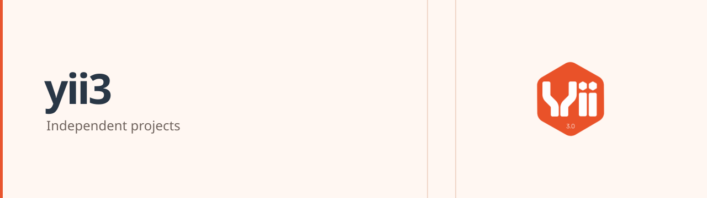

<!-- markdownlint-disable MD013 MD033 -->
<h1>
  <picture>
    <source media="(prefers-color-scheme: dark)" srcset="https://raw.githubusercontent.com/yii3/.github/main/profile/assets/yii3-cover-dark.png">
    <source media="(prefers-color-scheme: light)" srcset="https://raw.githubusercontent.com/yii3/.github/main/profile/assets/yii3-cover-light.png">
    
  </picture>
</h1>
<!-- markdownlint-enable MD013 MD033 -->

Independent integrations and reference applications for Yii3.

Explore debugging tools, an Inertia adapter, and a Vue reference application.
This organization is separate from the official Yii project at
[yiisoft](https://github.com/yiisoft). Read each repository's installation and
compatibility notes before choosing a version.

## Documentation and contribution

Use each repository's README for installation and integration instructions. The
[independent documentation portal](https://yii2-framework.github.io/docs/)
provides wider ecosystem context; it is not a documentation index for these
Yii3 packages.

Read the
[contribution guide](https://github.com/yii3/.github/blob/main/CONTRIBUTING.md)
before proposing a change. For security concerns, follow the
[security policy](https://github.com/yii3/.github/blob/main/SECURITY.md).

## Related projects

Explore [php-forge](https://github.com/php-forge),
[ui-awesome](https://github.com/ui-awesome),
[yii2-extensions](https://github.com/yii2-extensions), and
[yii2-framework](https://github.com/yii2-framework).

These are independent project collections. They and the documentation portal
are not official Yii resources. For upstream Yii, visit
[yiisoft](https://github.com/yiisoft).

## Support this work

If this work is useful to you, consider
[sponsoring @terabytesoftw on GitHub](https://github.com/sponsors/terabytesoftw).
